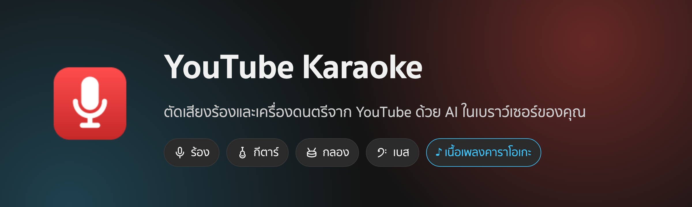
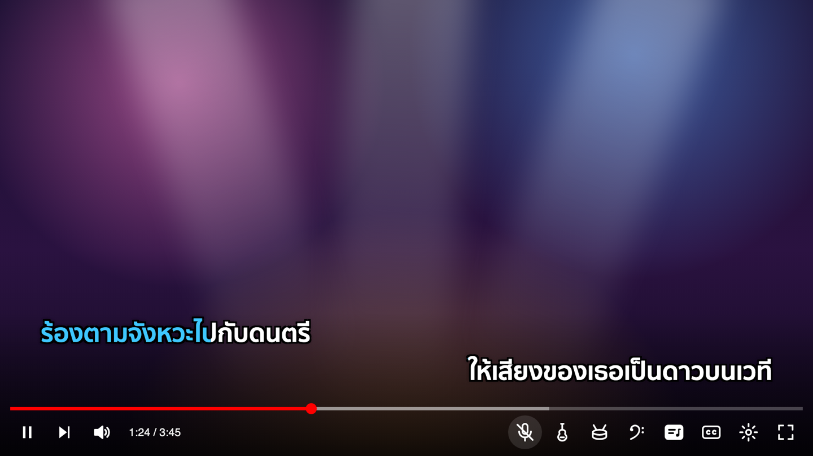
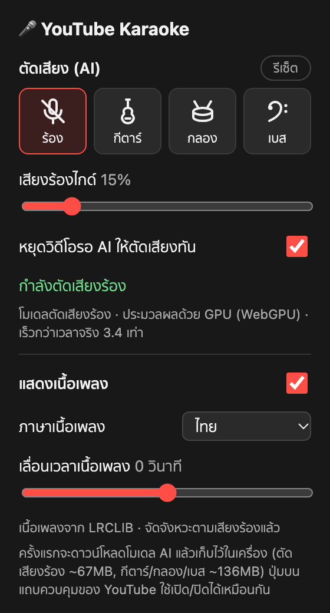
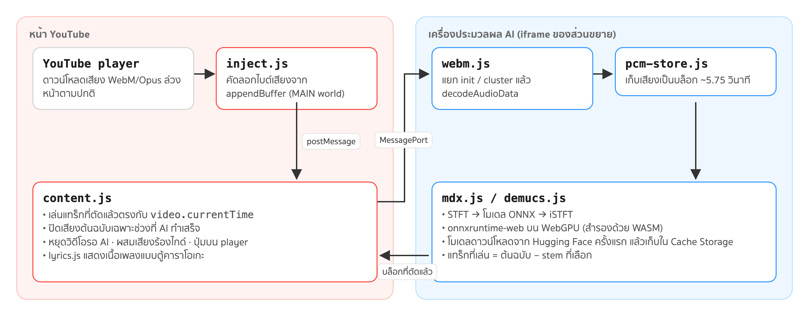

  
  
  

# YouTube Karaoke (Chrome Extension)

ตัดเสียงร้อง / กีตาร์ / กลอง / เบส จากวิดีโอ YouTube ด้วย AI ที่รันในเบราว์เซอร์ผ่าน WebGPU (เลือกตัดพร้อมกันได้ ใช้เป็น backing track ซ้อมดนตรี)
เสียงไม่ถูกส่งออกจากเครื่อง ([นโยบายความเป็นส่วนตัว](PRIVACY.md))

ภาพตัวอย่าง: ปุ่มร้อง / กีตาร์ / กลอง / เบส และปุ่มเนื้อเพลงบนแถบควบคุมของ YouTube (เสียงร้องกำลังถูกตัด) เนื้อเพลงสองบรรทัดพร้อมแถบสีวิ่งตามจังหวะ

## ความสามารถ

<table>
<tr>
<td width="300" valign="top"></td>
<td valign="top">

- **เลือกตัดได้หลายส่วนพร้อมกัน** ทั้งเสียงร้อง กีตาร์ กลอง และเบส จาก popup หรือจากปุ่มบน player
- **เสียงร้องไกด์** ผสมเสียงร้องต้นฉบับกลับเข้าไปเบาๆ สำหรับคนที่ยังจำเนื้อไม่ได้
- **ปรับคีย์เพลง** ±6 ครึ่งเสียงจาก popup โดยจังหวะเพลงไม่เปลี่ยน ใช้ได้ทั้งตอนตัดและไม่ตัดเสียง (ชดเชยความหน่วงให้เสียงตรงกับภาพเอง)
- **หยุดวิดีโอรอ AI** ตอนเริ่มเพลงหรือกรอเวลา เพื่อไม่ให้ได้ยินเสียงต้นฉบับหลุดมา
- **เนื้อเพลงแบบตู้คาราโอเกะ** จากคำบรรยายของคลิป, LRCLIB หรือคำบรรยายอัตโนมัติ จัดจังหวะตามเสียงร้องให้เอง
- **ประมวลผลในเครื่อง** ด้วย WebGPU ไม่ต้องสมัครบัญชีหรือใช้เซิร์ฟเวอร์ (popup บอกความเร็วเทียบกับเวลาจริงให้ดู)

</td>
</tr>
</table>

| ตัด | โมเดล | ขนาด |
|---|---|---|
| เสียงร้อง | MDX-Net "Kim_Vocal_2" (UVR) | ~67MB |
| กีตาร์ / กลอง / เบส | [HT-Demucs 6 stems](https://huggingface.co/StemSplitio/htdemucs-6s-onnx) (MIT) | ~136MB |

ตัดเสียงร้องอย่างเดียวใช้ Kim_Vocal_2 แต่ถ้าเลือกเครื่องดนตรีแม้แต่ชิ้นเดียว จะใช้ Demucs 6 stems ทำทั้งหมด (รวมเสียงร้องด้วย) ใช้ทีละโมเดลเท่านั้น

แทร็กที่เล่น = เสียงต้นฉบับ − stem ที่เลือกตัด (ส่วนอื่นจึงคงเดิมทุกอย่าง)

## ติดตั้ง
1. ดาวน์โหลด `youtube-karaoke-<เวอร์ชัน>.zip` จาก [Releases](https://github.com/lazymodthai/karaoke/releases/latest) แล้วแตกไฟล์
2. เปิด `chrome://extensions` → เปิด **Developer mode** → **Load unpacked** → เลือกโฟลเดอร์ที่แตกออกมา
3. เปิด (หรือรีโหลด) หน้า YouTube แล้วกดปุ่มไมค์บนแถบควบคุมวิดีโอ

วิธีอื่น (Chrome Web Store, ไฟล์ `.crx` ผ่าน policy) และวิธีอัปเดตดูที่ [docs/INSTALL.md](docs/INSTALL.md) · วิธีปล่อยเวอร์ชันใหม่ดูที่ [docs/RELEASING.md](docs/RELEASING.md)

## ติดตั้งจากซอร์สโค้ด (โหมดนักพัฒนา)
1. `npm install` (จะคัดลอก onnxruntime-web ไปไว้ที่ `extension/vendor/ort/` ให้อัตโนมัติ)
2. เปิด `chrome://extensions` → เปิด **Developer mode** → **Load unpacked** → เลือกโฟลเดอร์ `extension/`
3. เปิด (หรือรีโหลด) หน้า YouTube แล้วกดปุ่มไมค์บนแถบควบคุมวิดีโอ หรือเปิดจาก popup ของส่วนขยาย

ครั้งแรกที่ใช้แต่ละโมเดลจะดาวน์โหลดจาก Hugging Face แล้วเก็บไว้ใน Cache Storage ของส่วนขยาย

## การทำงาน

- ดึงเสียงจากบัฟเฟอร์ของ YouTube ล่วงหน้า (ก่อนเล่นจริง) แล้วประมวลผลทีละบล็อก ~5.75 วินาที
- `content.js` เล่นเสียงดนตรีที่แยกแล้วให้ตรงกับ `video.currentTime` และปิดเสียงต้นฉบับเฉพาะช่วงที่ AI ทำเสร็จแล้ว
- โหมด "หยุดวิดีโอรอ AI": ถ้าตำแหน่งที่กำลังเล่นยังไม่เสร็จ (เริ่มเพลง/กรอเวลา) จะหยุดวิดีโอรอแล้วเล่นต่อเอง
- "เสียงร้องไกด์" ผสมเสียงร้องที่แยกได้กลับเข้าไปเบาๆ
- ปรับคีย์: เสียงทั้งหมดผ่าน AudioWorklet (`src/audio/`) ที่เป็น phase vocoder แบบเลื่อนทั้งช่วงรอบยอดคลื่น (Laroche–Dolson) ซึ่งหน่วงเสียง 2048 แซมเปิล (~43ms) จึงป้อนเสียงที่ตัดแล้วล่วงหน้าเท่านั้นให้ตรงกับภาพ ถ้าคีย์เดิมจะไม่ผ่านตัวปรับคีย์เลย

## เนื้อเพลง (ปุ่มเนื้อเพลงบน player, ค่าเริ่มต้นปิด)
ลำดับแหล่งเนื้อเพลง:
1. คำบรรยายของคลิปในภาษาที่ร้อง (ให้ player โหลดเอง แล้วดักผลลัพธ์ใน `inject.js` เพราะ URL ต้องมี token ของ player; คืนค่าการตั้งค่าคำบรรยายของผู้ใช้หลังโหลด)
2. [LRCLIB](https://lrclib.net) เนื้อเพลงพร้อมเวลา ค้นจากชื่อคลิป/ช่อง เลือกผลที่ความยาวใกล้เคียง
3. คำบรรยายอัตโนมัติของ YouTube (เวลาทีละคำ แต่ข้อความอาจผิด)

แสดงแบบตู้คาราโอเกะ 2 บรรทัดสลับซ้าย/ขวา แถบสีวิ่งตามเวลา (รายคำถ้ามี ไม่งั้นทั้งบรรทัด) และปรับ "เลื่อนเวลาเนื้อเพลง" ได้ใน popup
เนื้อเพลงถูกดึงตอนใช้งานจากแหล่งข้างต้นเท่านั้น ส่วนขยายไม่ได้เก็บหรือแจกจ่ายเนื้อเพลงเอง

## ทดสอบ
- `npm test` — FFT, STFT/iSTFT, ตัวปรับคีย์, WebM parser, PCM store, ตัวแปลงเนื้อเพลง (json3/LRC/ชื่อคลิป/การเลือกบรรทัด)
- `node test/onnx-fix-eval.js <htdemucs_6s.onnx> <mix.raw>` — ยืนยันว่าโมเดล 6 stems ที่แปลงค่า double เป็น float แล้ว โหลดใน onnxruntime-web ได้ และผลตรงกับต้นฉบับ
- `node test/demucs-eval.js <htdemucs_6s.onnx> <voice.raw> <inst.raw>` — ทดสอบโมเดล 6 stems (ผลรวม stem, สัดส่วนพลังงาน, SDR เสียงร้อง)
- `node test/model-eval.js <Kim_Vocal_2.onnx> <voice.raw> <inst.raw>` — วัดคุณภาพการแยกเสียงด้วยโมเดลจริง (f32le stereo 44.1kHz)

## ข้อจำกัด
- ต้องการ GPU ที่รองรับ WebGPU เพื่อให้ทันเวลาจริง ถ้าไม่มีจะใช้ CPU (WASM) ซึ่งช้ากว่าเวลาจริง
- รองรับเฉพาะเสียง WebM/Opus (ส่วนขยายบังคับให้ YouTube เลือก Opus)
- ไลเซนส์ของน้ำหนักโมเดล Kim_Vocal_2 (จากชุดโมเดล UVR) ควรตรวจสอบก่อนเผยแพร่เชิงพาณิชย์

## ☕ สนับสนุน
ถ้าชอบส่วนขยายนี้ สามารถสนับสนุนผ่าน PromptPay ได้ครับ

